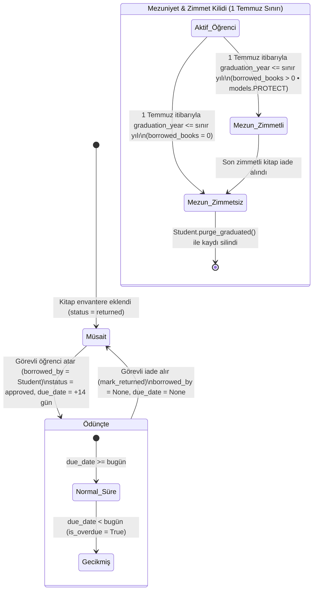

<div align="center">
  
  <h1>SKAL Kütüphanesi</h1>
  <p><strong>Çiğli Sezai Karakoç Anadolu Lisesi Dijital Kütüphane Katalog ve Yönetim Sistemi</strong></p>
  <p>
    <a href="#mimari-ve-iş-akışı">Mimari</a> •
    <a href="#proje-yapısı-ve-dokümantasyon">Proje Yapısı</a> •
    <a href="#kurulum-ve-çalıştırma">Kurulum</a> •
    <a href="#docker-ve-canlı-ortam">Docker</a> •
    <a href="#ortam-değişkenleri">Ortam Değişkenleri</a> •
    <a href="#yönetim-komutları-ve-testler">Test & Komutlar</a>
  </p>
</div>

---

**SKAL Kütüphanesi**, Çiğli Sezai Karakoç Anadolu Lisesi kütüphanesinin kitap envanterini, öğrenci ödünç/iade süreçlerini ve akademik takvime dayalı mezuniyet yaşam döngüsünü yönetmek için **Django 6.1** ve **Django Unfold** üzerine inşa edilmiş iki katmanlı bir web uygulamasıdır.

## İki Katmanlı Sistem Mimarisi

1. **Halka Açık Salt-Okunur Dijital Katalog (`/` • `/search/` • `/books/`):**
   - **Editoryal Vitrin (`/`):** Okul kimliğini yansıtan karşılama sayfası, gerçek zamanlı kütüphane istatistikleri (*Toplam Eser*, *Rafta Müsait*, *Ödünçte*), öne çıkan kitap seçkisi, hızlı arama kapsülü ve 3 adımlı fiziksel ödünç alma rehberi.
   - **Mobil Öncelikli Arama ve Katalog (`/search/` ve `/books/`):** Öğrencilerin telefon veya bilgisayarlarından kitap adı/yazar araması (`q`) yapabildiği, durum filtreleyebildiği (`status=available|borrowed`) ve sıralayabildiği (`sort=name|author|availability|due_date`) katalog arayüzü.
   - **Sıfır Öğrenci Girişi ve KVKK Uyumlu Gizlilik:** Halka açık yüzeyde öğrenci hesabı, parola, oturum açma veya web üzerinden ödünç/iade talebi gönderme akışı bulunmaz. Öğrencilerin ad-soyad (`full_name`) ve okul numarası (`student_number`) bilgileri halka açık HTML şablonlarında veya DOM özniteliklerinde **asla yer almaz**; ziyaretçiler yalnızca kitabın durumunu (`Müsait` / `Ödünçte`) ve ödünçteyse `Son İade Tarihi (GG.AA.YYYY)` bilgisini görür.

2. **Kütüphane Görevlisi Yönetim Paneli (`/admin/`):**
   - **Django Unfold Gösterge Paneli:** Toplam kitap, müsait kitaplar, ödünçteki kitaplar, gecikmiş iadeler, kayıtlı öğrenciler ve zimmetli mezunlar için canlı KPI kartları ile yan menüde gecikmiş kitap bildirim rozeti (`overdue_books_badge`).
   - **Otomatik 14 Gün İade Hesaplama:** Görevli bir kitaba kayıtlı öğrenci (`Student`) atadığında kitap durumu otomatik olarak `Ödünçte` (`approved`) olur, ödünç tarihi (`borrowed_at`) bugüne ve son iade tarihi (`due_date`) varsayılan 14 gün sonrasına ayarlanır.
   - **Akademik Takvim (1 Temmuz) Mezuniyet Otomasyonu ve Zimmet Kilidi (`PROTECT`):** Her yıl **1 Temmuz** itibarıyla mezuniyet yılı (`graduation_year`) dolan öğrencilerden üzerinde ödünç kitap bulunmayanlar otomatik olarak silinir (`Student.purge_graduated()`). Üzerinde iade edilmemiş kitap bulunan mezunlar veritabanı seviyesinde `models.PROTECT` (**Zimmet Kilidi**) ile korunur; son kitap iade alındığında mezun öğrenci kaydı otomatik temizlenir.

---

## Mimari ve İş Akışı

### 1. Sistem Bileşenleri ve Veri Akışı

```mermaid
flowchart LR
    subgraph Public["Halka Açık Salt-Okunur Katalog (KVKK Korumalı)"]
        Home["Vitrin (/)\nCanlı İstatistik & Öne Çıkanlar"]
        Catalog["Arama & Katalog (/search/, /books/)\nYalnızca Müsait/Ödünçte & İade Tarihi"]
    end

    subgraph Staff["Kütüphane Görevlisi Paneli (/admin/)"]
        Dashboard["Unfold Gösterge Paneli\nCanlı KPI & Gecikme Rozeti"]
        BookAdmin["Kitap Yönetimi (BookAdmin)\nÖdünç Atama & Toplu İade"]
        StudentAdmin["Öğrenci Yönetimi (StudentAdmin)\nMezuniyet & Zimmet Takibi"]
    end

    subgraph Domain["Alan Modeli ve Veritabanı (library/models.py)"]
        BookModel["Book\nstatus: returned | approved\nCheckConstraint & 14 Gün Kuralı"]
        StudentModel["Student\ngraduation_year & 1 Temmuz Sınırı\non_delete=models.PROTECT"]
    end

    Home -->|GET| BookModel
    Catalog -->|GET| BookModel
    Dashboard --> BookModel
    Dashboard --> StudentModel
    BookAdmin -->|assign_to_student / mark_returned| BookModel
    StudentAdmin -->|purge_graduated| StudentModel
    BookModel -->|borrowed_by (PROTECT)| StudentModel
```

### 2. Kitap Durum Geçişleri ve Mezuniyet Yaşam Döngüsü

Veritabanı seviyesinde `book_status_borrower_consistency` kısıtı (`CheckConstraint`) ile kitabın yalnızca iki geçerli durumu vardır: **`returned` (Müsait)** ve **`approved` (Ödünçte)**.



---

## Proje Yapısı ve Dokümantasyon

```text
skallibrary/
├── config/
│   ├── settings.py          # Django 6.1, Unfold, WhiteNoise ve üretim güvenliği ayarları
│   ├── urls.py              # Kök URL yönlendirmeleri (/admin/ ve library.urls)
│   ├── wsgi.py              # Gunicorn WSGI giriş noktası
│   └── asgi.py              # ASGI giriş noktası
├── library/
│   ├── models.py            # Student ve Book modelleri, CheckConstraint, 14 gün ve mezuniyet kuralları
│   ├── views.py             # Halka açık salt-okunur görünümler (home, book_list)
│   ├── urls.py              # Halka açık rotalar (/, /search/, /books/)
│   ├── admin.py             # Unfold tabanlı BookAdmin, StudentAdmin ve toplu aksiyonlar
│   ├── dashboard.py         # Yönetim paneli KPI kartları ve gecikmiş iade rozeti
│   ├── management/commands/
│   │   └── purge_graduated_students.py  # Zimmetsiz mezun öğrencileri temizleyen yönetim komutu
│   ├── migrations/          # Veritabanı şema geçişleri (0001–0008)
│   ├── static/library/      # CSS (style.css, admin_custom.css), JS (main.js, admin_tour.js) ve okul amblemi
│   ├── templates/library/   # base.html, home.html (Vitrin), books.html (Katalog)
│   └── tests.py             # Birim, entegrasyon, KVKK gizlilik, güvenlik ve sorgu bütçesi testleri
├── .github/workflows/ci.yml # GitHub Actions test ve GHCR Docker imaj yayınlama hattı
├── Dockerfile               # Python 3.12-slim tabanlı üretim konteyner tanımı
├── docker-compose.yml       # Gunicorn + kalıcı medya hacmi servis tanımı
├── entrypoint.sh            # Konteyner başlangıç betiği (migrate & purge_graduated_students)
├── DESIGN.md                # Dyotanya Editorial Sketchbook & SKAL Logo Renk Paleti Tasarım Sistemi
├── AGENTS.md                # Mühendislik standartları, iş kuralları ve ajan çalışma kılavuzu
└── requirements.txt         # Sabitlenmiş (pinned) Python bağımlılıkları
```

> [!TIP]
> **Detaylı Mimari ve Tasarım Belgeleri:**
> - **Tasarım Sistemi (`DESIGN.md`):** Halka açık vitrin ve katalogda uygulanan *Dyotanya Editorial Sketchbook* tasarım dili, sadece açık tema (`color-scheme: light`) kuralı, `#f5f5f3` sıcak kağıt zemini, `#282471` kurumsal lacivert sert ofset gölgeler, `#ec782b` başak turuncusu vurgular ve `Playfair Display` + `Manrope` tipografi ölçeği için **[DESIGN.md](DESIGN.md)** belgesini inceleyin.
> - **Mühendislik ve Mimari Kılavuz (`AGENTS.md`):** Alan modeli kısıtları, KVKK gizlilik kuralları, N+1 sorgu koruması ve TDD doğrulama adımları için **[AGENTS.md](AGENTS.md)** belgesine başvurun.

---

## Kurulum ve Çalıştırma

### Yerel Geliştirme Ortamı

1. **Sanal ortamı oluşturun ve bağımlılıkları yükleyin:**
   ```bash
   python -m venv venv
   source venv/bin/activate  # Windows PowerShell: .\venv\Scripts\Activate.ps1
   pip install -r requirements.txt
   ```

2. **Veritabanı şemasını oluşturun ve yönetici hesabı tanımlayın:**
   ```bash
   python manage.py migrate
   python manage.py createsuperuser
   ```

3. **Geliştirme sunucusunu başlatın:**
   ```bash
   python manage.py runserver
   ```

- **Vitrin:** `http://127.0.0.1:8000/`
- **Mobil Öncelikli Katalog ve Arama:** `http://127.0.0.1:8000/search/` (veya `/books/`)
- **Kütüphane Görevlisi Yönetim Paneli:** `http://127.0.0.1:8000/admin/`

---

## Docker ve Canlı Ortam

Proje, Python 3.12-slim, Gunicorn ve WhiteNoise ile paketlenmiş üretim hazır bir Docker yapılandırması içerir.

```bash
cp .env.example .env
# .env dosyasındaki DJANGO_SECRET_KEY, DJANGO_ALLOWED_HOSTS ve DATABASE_URL değerlerini düzenleyin

docker compose up -d
```

**Konteyner yaşam döngüsü (`Dockerfile` & `entrypoint.sh`):**
- İmaj derlenirken `python manage.py collectstatic --noinput` çalıştırılarak statik dosyalar WhiteNoise için hazırlanır.
- Konteyner her başlatıldığında `entrypoint.sh` sırasıyla:
  1. `/app/media` dizinini hazırlar (`./media:/app/media` olarak ana makinede kalıcıdır).
  2. `python manage.py migrate --noinput` ile veritabanı geçişlerini uygular.
  3. `python manage.py purge_graduated_students` komutuyla mezuniyet yılı dolmuş ve zimmetli kitabı olmayan öğrencileri temizler.
  4. `gunicorn config.wsgi:application --bind 0.0.0.0:8000 --workers 2 --threads 4` ile uygulamayı başlatır.
- **CI/CD (`.github/workflows/ci.yml`):** `main` dalına yapılan her `push` ve `pull_request` işleminde Django test paketi çalıştırılır; `main` dalındaki başarılı derlemeler `ghcr.io/<repo>:latest` olarak GitHub Container Registry'ye yüklenir.

---

## Ortam Değişkenleri

Yapılandırma `config/settings.py` tarafından ortam değişkenlerinden okunur. Örnek şablon için [`.env.example`](.env.example) dosyasına bakın.

| Değişken | Varsayılan (`DEBUG=True`) | Üretim (`DEBUG=False`) | Açıklama |
| :--- | :--- | :--- | :--- |
| `DJANGO_SECRET_KEY` | Geliştirme anahtarı | **Zorunlu** (`ImproperlyConfigured` fırlatır) | Django kriptografik imzalama anahtarı (en az 50 karakter önerilir). |
| `DJANGO_DEBUG` | `True` | `False` | Hata ayıklama modu. `False` olduğunda güvenlik başlıkları ve WhiteNoise sıkıştırmalı statik sunumu devreye girer. |
| `DJANGO_ALLOWED_HOSTS` | `localhost,127.0.0.1` | `kutuphane.skal.k12.tr,localhost` | Virgülle ayrılmış izin verilen alan adları listesi. |
| `DJANGO_CSRF_TRUSTED_ORIGINS` | `""` (Boş) | `https://kutuphane.skal.k12.tr` | Virgülle ayrılmış güvenilir CSRF kaynak adresleri (`https://` şeması ile). |
| `DJANGO_SECURE_SSL_REDIRECT` | Devre dışı | `True` | `DEBUG=False` iken HTTP isteklerini otomatik olarak HTTPS'e yönlendirir. |
| `DJANGO_SECURE_HSTS_SECONDS` | Devre dışı | `31536000` (1 yıl) | `DEBUG=False` iken HTTP Strict Transport Security (HSTS) süresi (saniye). |
| `DATABASE_URL` | Yerel SQLite | PostgreSQL bağlantı dizgesi | Tanımlıysa PostgreSQL (örn. Neon Postgres) kullanılır; tanımlı değilse yerel SQLite'a düşer. |
| `DJANGO_DB_PATH` | `./db.sqlite3` | `./db.sqlite3` | `DATABASE_URL` tanımlanmadığında kullanılacak yerel SQLite dosya yolu. |

---

## Yönetim Komutları ve Testler

### Mezun Öğrenci Temizleme Komutu

Akademik takvime göre (1 Temmuz sınırı) mezuniyet yılı geçmiş ve üzerinde ödünç kitap bulunmayan öğrencileri veritabanından temizlemek için:

```bash
python manage.py purge_graduated_students
```

- Üzerinde aktif ödünç kitap bulunan mezun öğrenciler **Zimmet Kilidi** (`models.PROTECT`) sayesinde silinmez ve komut çıktısında korunan öğrenci sayısı ayrıca raporlanır:
  `"<silinen> mezun öğrenci kaydı silindi. Zimmetli kitabı bulunan <korunan> mezun öğrenci korundu."`

### Test ve Doğrulama Komutları

Kod tabanındaki model kısıtlarını, KVKK gizlilik garantilerini, görünüm sorgu bütçelerini ve yönetim paneli davranışlarını doğrulamak için:

```bash
# Tüm test paketini çalıştır
python manage.py test --verbosity=2

# Django sistem ve yapılandırma doğrulaması
python manage.py check

# Eksik veya senkronize olmayan migration kontrolü
python manage.py makemigrations --check --dry-run
```

---

## Lisans

Bu proje **GNU Affero General Public License v3.0 (AGPL-3.0)** kapsamında lisanslanmıştır. Ayrıntılar için [LICENSE](LICENSE) dosyasına bakabilirsiniz.
